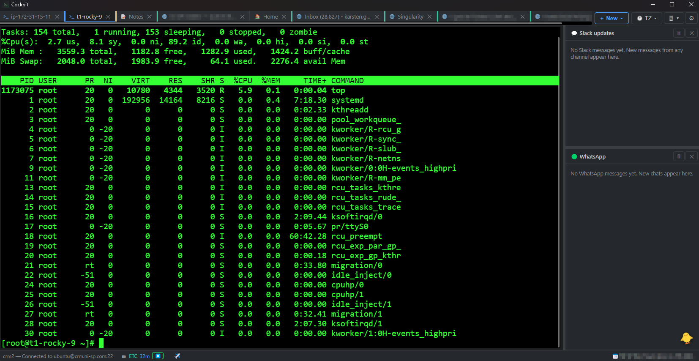
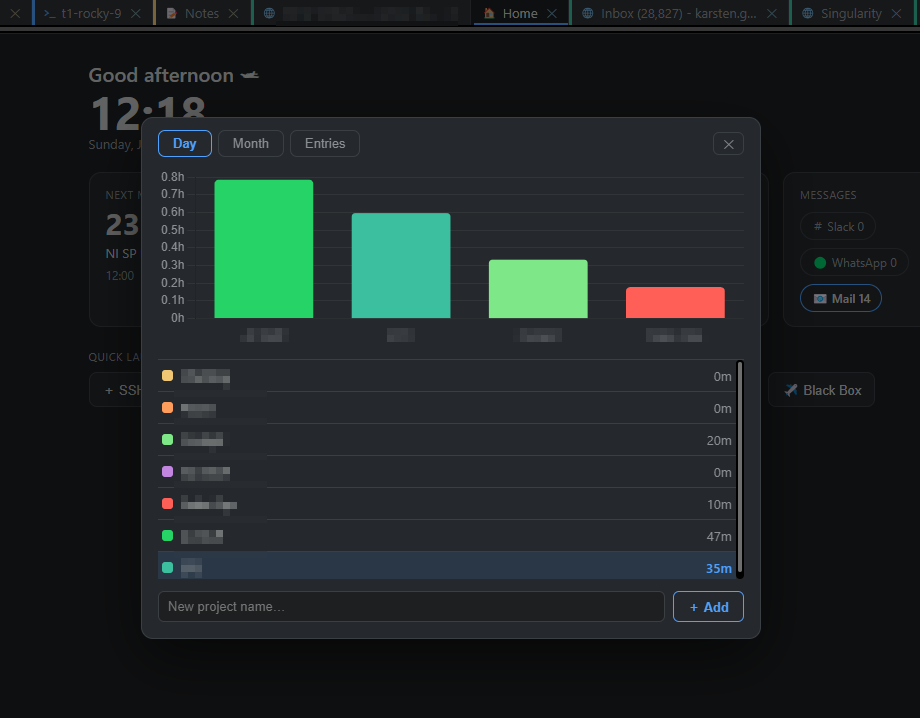
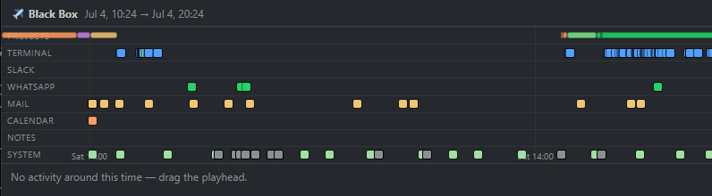
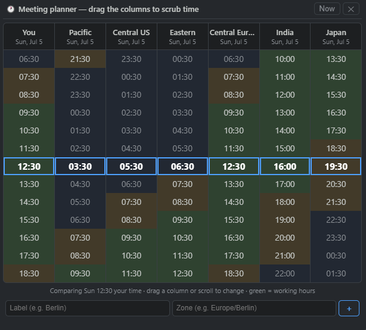
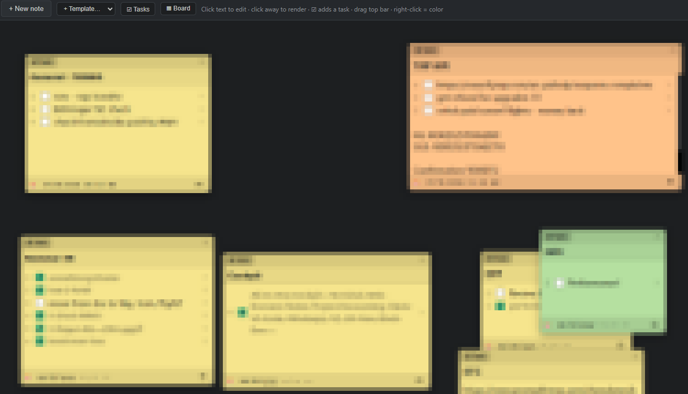

# Cockpit

**All-In-One Cockpit** - Terminal, Web Browser, Notes, Project Accounting, GMail/GCal,
Slack, WhatsApp, VS Code, TZ, 3D View, Black Box, …

A tabbed, colorful control center for Windows (and Mac/Linux) that puts all of it in one
window. Started life as a PuTTY-style SSH client (liked PuTTY, not MobaXterm): full
ANSI/256/truecolor, SSH-key auth.

## Download

**Windows:** get the portable `.exe` from the
**[latest release](https://github.com/NISP-GmbH/Cockpit/releases/latest)** and run it - no
installer. It is not code-signed yet, so SmartScreen may warn on the first start: **More info**
→ **Run anyway**. **macOS / Linux:** run it from source (see [Run](#run)).

## Screenshots

**Terminals** - full-color SSH/local tabs with the live message boards in the right sidebar:



**Command Deck + project accounting** - the home dashboard with the Day/Month time overview:



**Black Box** - a scrubbable timeline of your activity, with a project-time lane on top:



**Timezone meeting planner** and the **notes & tasks** board:





## Stack
- **Electron** - desktop shell (main / preload / renderer, context-isolated)
- **[xterm.js](https://xtermjs.org/)** - the terminal engine VS Code uses (true color, vim/htop/etc. render correctly)
- **[ssh2](https://github.com/mscdex/ssh2)** - pure-JS SSH client · **[node-pty](https://github.com/microsoft/node-pty)** - local shells
- **[Baileys](https://github.com/WhiskeySockets/Baileys)** - WhatsApp · **[@slack/*](https://slack.dev)** - Slack Socket Mode · **googleapis** - Gmail/Calendar
- **[three.js](https://threejs.org/)** - 3D Exposé · **[Chart.js](https://www.chartjs.org/)** - project-time charts · **[code-server](https://github.com/coder/code-server)** - in-tab VS Code

## Features

Everything lives in one tabbed window (`Ctrl+Shift+T` new · `Ctrl+Shift+W` close · `Ctrl+Tab` switch).

**Terminals**
- **SSH** - Windows OpenSSH **ssh-agent**, a **private key** (with passphrase), or **password** fallback; auto-detects keys in `~/.ssh` / `%USERPROFILE%\.ssh`. Full ANSI/256/truecolor, 10k scrollback, clickable links (open in an in-app web tab), live resize, PuTTY-style copy-on-select / right-click paste (a line the terminal broke across rows is copied as **one line** - untick in ⚙ if you want the breaks; 🔗 **Copy as one line** on the hover sheet handles word-wrapped output too), font zoom (`Ctrl +/-/0`), scrollback search (`Ctrl+Shift+F`).
- **Local shell** tabs (PowerShell/cmd on Windows, `$SHELL`/zsh/bash on macOS/Linux) via a real PTY - same terminal UI, from **＋ New → Local terminal**.
- **Broadcast typing** (⇄ in the tab bar) - mirror your keystrokes from the focused terminal to every other connected ssh/local tab, so you run a command once and it lands everywhere. The button shows the member count; participating terminals get an orange badge, and any tab can opt out from its hover cheat-sheet.
- **Saved sessions** (host/port/user/key path) - secrets are never written to disk. **SSH auto-hop** optionally replays `ssh …` jump commands on connect (opt-in). Dropped session? **R** to reconnect, **P** to re-enter a passphrase. **📐 Fix the size** (tab hover cheat-sheet) tells the far end how big this terminal is - the resize signal, plus `stty` and `tmux refresh-client` in words, because tmux keeps whatever size its client had when it attached and a signal alone does not always reach it. It runs on its own after connecting; press it when a pane is the wrong size. Reconnecting **re-asserts the terminal size**, so a re-attached `tmux` session or a full-screen app gets the real geometry instead of falling back to 80x24 - no more dragging the window edge to make it snap.
- **`ssh://` link handler** (Settings → ssh:// links, opt-in) - register Cockpit as the system handler for `ssh://user@host:port` links, so clicking one anywhere opens a new terminal and connects. If a **jump / bastion host** is set (pick a **saved SSH session** from the dropdown, or type one), Cockpit connects there first and then runs `ssh user@host` to reach the target. Off by default; unchecking it hands `ssh://` back to your other tools.
- **Resilient SSH auth** - agent auth automatically **falls back to your `~/.ssh` keys** (like OpenSSH), so a stopped/empty agent isn't a dead end; a failing agent is a note, not a failed connection. (Cockpit uses the `ssh2` library, not the `ssh` binary.)
- Optional per-terminal **line numbers** for command output. **SFTP** file browser for the active SSH tab (drag-and-drop upload/download). New output **auto-scrolls** to the bottom (unless you've scrolled up to read history); `Ctrl+PageUp`/`Ctrl+PageDown` page the scrollback. **Shift+scroll** instead writes keys to the remote app, so you can scroll inside full-screen apps (tmux, `less`, vim, Claude Code) that own the screen and have no local scrollback. Which keys is configurable in ⚙ → **Terminal scrolling** (`PgUp`/`PgDn`, tmux copy-mode, `Ctrl+B`/`Ctrl+F`, arrows, an SGR mouse report, or your own sequence) because every app binds paging differently - notably, some editors bind `PgUp`/`PgDn` to jump to the start/end of the input rather than scroll. For tmux the simplest answer is usually `set -g mouse on`, after which a plain scroll works natively. On keyboards without `PageUp`/`PageDown` keys (Mac laptops, 60% boards), `Alt+Shift+↑/↓` sends the same configured sequence and `Ctrl+Shift+↑/↓` pages the local scrollback - the key bytes are synthesized, so the physical key never has to exist. In **tmux copy-mode** mode, scrolling up parks the pane in copy-mode (leave it with `q`, Escape or Enter); by default Cockpit sends that `q` for you the moment you start typing, so typing just resumes - untick **Leave copy-mode as soon as I type** if you would rather stay there to search or select.
- **Record session → asciicast** (tab hover cheat-sheet → ⏺ Record session) - record a terminal to a standard **asciicast v2 `.cast`** file: the raw output stream is captured with timing, and on stop you're prompted to save. Replay it with `asciinema play file.cast`, embed a player, or convert it to a GIF - great for dropping a repro/how-to into a ticket or PR. The tab shows a pulsing red ● while recording; a 25 MB safety cap auto-stops runaway captures. Works on ssh and local tabs.
- **Time travel** (tab hover cheat-sheet → 🕰 Time travel) - Cockpit keeps a bounded rolling capture of every terminal's output, so you can **scrub the terminal backward through time** with a slider and see its exact **state at any past moment** - before that `clear`, before the deploy, "what did this look like 3 minutes ago." It replays the captured stream into a read-only terminal (so cursor moves / clears / colors reconstruct faithfully), with a live time label and a "▶ latest" jump. Live output keeps flowing in the real tab. Rolling window is ~4 MB per terminal.
- **⚡ Explain** (`Ctrl+Shift+E`, or the tab hover cheat-sheet; with the fast AI reply set up) -
  select an error in a terminal (or select nothing: the last lines on screen) and a popover explains
  it in plain words, with one command that would fix it or find out more. **⌨ Type it** puts the
  command at the prompt WITHOUT Enter - nothing runs until you press it - or **Copy** it.
- **⚡ Plain English → command** - type `# find files over 1 GB here` at the prompt and press
  `Ctrl+J`: the line is replaced by the command (not run; check it, then Enter). It knows the
  host, folder, shell and your last command. A request that needs several lines is shown to copy
  instead of typed; one the model thinks unsafe is explained, not typed. Without a `# request` on
  the line - or inside vim, tmux and other full-screen apps - `Ctrl+J` stays the shell's.
- **Selection → note** (tab hover cheat-sheet → 🗒 Selection → note, or **Ctrl+Shift+N**) - select any terminal output and drop it straight into a sticky note, **auto-tagged** with the host, a timestamp, and **the command that produced it** (pulled from the tab's command tracker). The selection is stored fenced so it renders monospaced, and the note board opens and flashes the new note. Works on ssh and local tabs - handy for saving an error, a config snippet, or a one-off result you want to keep next to your tasks.
- **Where am I** (tab hover cheat-sheet → 📍) - the tab title tracks the **real host and directory** of
  whatever shell the terminal is currently in, however deep: `ssh` inside `ssh`, `sudo`, a container.
  Cockpit reads it for free when the shell offers it (OSC 7, or a `user@host:cwd` window title), and
  otherwise asks in-band with the same trick as the file grab - one command wrapped in unique markers,
  with the whole exchange swallowed, so the terminal looks untouched. That question is asked **on demand**
  (📍 on the tab hover sheet); asking by itself - after connecting and when you switch to a tab - is **off
  unless you switch it on** in ⚙ → Terminal ("Find out host and folder by itself ..."), because it types
  into the terminal. Either way it is only typed at a **shell prompt**: never while a program runs - not on
  the alternate screen (`vim`, tmux copy-mode), and not in **Claude Code**, which draws on the normal
  screen (a program that hid the cursor, Claude Code's own words on screen, or a cursor line that does not
  end like a prompt all count as "not now"). The same rule keeps the size resync and the tmux picker out.
- **🪟 tmux sessions** - when an SSH tab connects to a host that has tmux sessions, a small card
  in the corner offers them (windows, whether they are open elsewhere, when last active): one
  click attaches, or start a named new one. It asks only when the shell is idle at a prompt and
  you have not started typing, never inside tmux or while a terminal preset is running (the
  preset decides what that terminal does), and typing puts it away; **Do not ask on this
  host** is remembered (Settings resets it, or turns the whole thing off). The tab hover sheet's
  **🪟 tmux sessions** (or the command palette) opens it on any tab at any depth - inside tmux it
  switches sessions instead of nesting one.
- **📋 Clipboard history** (`Ctrl+Shift+H`, the 📋 in the status bar, or the command palette) -
  the last 50 things you copied, in Cockpit or any other app, **kept in memory only** (gone when
  Cockpit quits). Enter or a click pastes into where you were - the terminal, or the text field
  you had open; Shift+Enter only copies. Anything that looks like a **secret** - a password
  manager's copy, a private key, an API or access token, a JWT, `password=...`, a password-like
  string - is shown masked, never matched by the filter, and **removed after a minute**; if it
  is still on the clipboard then, the clipboard is cleared too (Settings can leave it there).
- **Send a file here** (tab hover cheat-sheet → 📤) - the mirror of the grab below: pushes a file **into the shell this terminal is in right now**, so on a multi-hop `ssh` it lands on the **last** hop, not the first - and it reaches inside `sudo` or a container too. The bytes are base64 and typed through the terminal in chunks, with the whole exchange hidden, and the size is checked on arrival. Small files only (1 MB cap); use **📁 Files** for anything larger.
- **📁 Files (SFTP)** (the 📁 button on the top bar, the tab hover cheat-sheet, or ＋ New ▾ → 📁 Files) - browse the host you connected to: **📤 Upload**, download, and move around. You can also **drag files onto the terminal**. SFTP is attached to the first hop, so it does not follow further `ssh` hops - that is what Send a file here is for. While a file goes over SFTP (either way, from the panel or dropped on a terminal), a card in the bottom left corner shows **which file** (and which of how many), a progress bar, how much is done, the speed and the **time left**; it goes by itself a moment after the end, and a failed transfer stays a little longer with the reason.
- **Grab / preview a file from here** (tab hover cheat-sheet → 📥 Get a file) - reaches a file straight through the current terminal session, so it works even inside a **nested `ssh`**, `sudo`, `tmux`, or a container where SFTP can't reach. Two options: **👁 Preview** shows the contents in a scrollable viewer (`.json` pretty-prints; **`.log`/`.out`/`.err` jump to the end** so you see the newest lines; binary files are declined), and **📥 Download** saves it. The transfer is hidden from the terminal (a short `[sending file …]` note stands in for the base64), leaving no clutter. The host also reports the file size, and a transfer that arrives a different size is **refused rather than saved** - a long stream can be mangled by anything that redraws the terminal instead of passing bytes through (tmux, screen), and a silently corrupt file is worse than none. Best for small and medium files; use 📁 Files (SFTP) for large ones.
- **Port forwarding** (tab hover cheat-sheet → 🔀 Port forwarding) - a visual SSH tunnel manager for the active connection. Port forwarding is confusing because it's hard to picture *who listens* and *which way traffic flows*, so each tunnel is drawn as a **three-node diagram** - your PC, the SSH host, the target - with a 📡 LISTENS pin and directional arrows, plus a plain-English sentence, and a live preview updates as you fill the form. Supports **Local (`-L`)** (reach an internal service from your machine), **Remote (`-R`)** (expose something of yours on the server), and **Dynamic (`-D`)** (a built-in SOCKS5 proxy). Each active tunnel shows a status dot, live connection count and bytes up/down, with a Stop button. Optionally **remember** a tunnel per host so it **auto-starts on connect**. An "allow other devices (0.0.0.0)" toggle exposes a local tunnel to your LAN. The panel is **draggable** by its header (double-click the header to re-center).
- **Host vitals** (Terminal ▾ → 📈 Host vitals, opt-in) - a tiny live CPU / MEM / DISK sparkline strip in the **status bar**, next to the active SSH shell's name, so you can eyeball a box's health without opening `htop`. Each host is polled over a **separate exec channel** (default every 15 s, selectable 5/15/30/60 s in the same menu), so it never disturbs your interactive shell. CPU is load1 ÷ cores; colours go green → amber → red as a metric climbs. **Hover** the strip for absolute figures (e.g. `MEM 29% of 33 GB (9.6 GB used)`, `DISK 82% of 500 GB`, plus load and core count). Linux-oriented (reads `/proc` + `df`); unavailable values show `n/a`.
- **Smart output** (Terminal ▾ → 🔎 Smart output, on by default) - makes things in the terminal scrollback clickable: click an **IP** (with optional `:port`) to open a pre-filled SSH connection, a **file path** to grab it through the current session, or a **JSON** object/array to pretty-print it in a copyable pop-up - this works on both compact single-line JSON and pretty-printed **multi-line** blocks (e.g. `cat file.json`), where clicking any line pops the enclosing object/array. URLs keep opening in an in-app web tab. IPs inside URLs are left alone; only text that actually parses as JSON gets a link. A `.json` file (a path, or a filename in an `ls -l` row) **previews structured** immediately (fetched in-band, with a Save button in the viewer). Filenames in an `ls -l` listing are grabbable too - including names with spaces, quotes or umlauts, which `ls` prints quoted (`'Price List 2026.pdf'`): the real name is used, not the quoted one. The Get-a-file dialog accepts a pasted quoted name or `My\ Docs/a.pdf` the same way.
- **Actionable output** (part of Smart output) - Cockpit also recognises **things you act on** in terminal output and gives them a verb menu on click: a **PID** (in `ps aux`/`ps -ef`) → info / tree / lsof / renice / kill; a **container id** (in `docker ps`) → logs / inspect / stats / exec / stop / restart; a **systemd unit** (anything ending `.service` / `.socket` / `.timer` / `.target` / `.mount`) → status / journal / restart / stop / start. **Read-only** verbs (green) run immediately; **mutating** verbs are typed at your prompt so you review and press Enter.

**Command Deck (🏠 Home)** - a live dashboard tab (**＋ New → Home**): greeting + clock, the **next meeting** with a one-click **Join**, **today's project time** (start/pause + Projects shortcut), **open/overdue tasks**, unread **Slack/WhatsApp/Mail** counts, and a **quick-launch** row for every tab type. Refreshes every second.

**Tabs & window**
- Drag to **reorder**, **double-click a tab title to rename**; tabs persist and reopen in place across restarts. **Empty start** with quick actions instead of a forced dialog. **Command palette** (`Ctrl+L`, fuzzy jump/run). Resizable **right sidebar** (drag the dividers).

**Web browser** - `<webview>` tabs with bookmarks, back/forward/reload (**Alt+←/→** too, like Chrome - they work whether focus is in the page or the URL bar), **Ctrl/Cmd+wheel zoom**, **find in page** (`Ctrl/Cmd+F`), open-in-external, DevTools (`F12`), and unpacked Chromium **extensions**. Links that ask for a new window (`target="_blank"`, `window.open`) open as **a new Cockpit tab** instead; **Ctrl/middle-click** puts it in the background without stealing focus, and **Shift+click** still gets a real separate window. Sized popups (OAuth consent, payment flows) keep getting a window too, since that is what they need. **Right-click menu** in pages: on an **image** - *Save image as…*
(the Save dialog starts in your Downloads folder), *Copy image*, *Copy image address*, *Open image in new tab*,
*Search image with Google Lens*; on a **link** - open in a new tab, copy the address, save it; on **selected
text** - copy, **📝 save as a sticky note**, search Google; in a **text field** - spelling suggestions, cut / copy /
paste / select all; anywhere else - back / forward / reload; and always *Inspect*.

**VS Code** - launch a full **[code-server](https://github.com/coder/code-server)** VS Code in a tab; auto-installs on first use (macOS/Linux) and relaunches a restored VS Code tab on startup.

**Messaging** - **Slack** and **WhatsApp** as tabs *and* as live right-sidebar **boards** (latest messages across all channels/chats, click to jump). Slack via Socket Mode; WhatsApp via QR login (no API key). Capture any message to a note.

**Google** - a **📧 Mail tab** (Gmail in a tab: triage from the keyboard, reply / forward, attachments straight into a shell), a **📅 Calendar tab** (your week, drag to make or move events), the Inbox board + **Calendar** bar with countdown, a **centered pop-up that raises the window for an imminent meeting** (with a one-click **Join**), and capture-email-to-note.

**Terminal presets** - a terminal that sets itself up. A preset is a name and a list of steps that Cockpit
types for you: `ssh` somewhere, wait, attach to tmux, set the tab title. You write them once, as plain text,
in ⚙ → **⚡ Terminal presets** (or ＋ New ▾ → ⚡ Presets → ✎ Edit presets…):

```
[Pen]
start: local
title: pen
ssh admin@pen
wait-prompt
tmux attach -t main

[Server]
ask: host = db1
title: srv-{host}
ssh admin@{host}
wait-prompt
tmux attach -t main

[Logs]
start: my saved connection
cd /var/log
tail -f syslog
```

A name in brackets starts a preset; then one step per line:

| Line | What it does |
|---|---|
| any other line | typed into the terminal, with Enter |
| `wait-prompt` | goes on when the shell is back at its prompt - whatever your prompt looks like. If ssh asks for a password or a yes/no on the way, the strip says so: you answer it, the preset goes on after. Waits 2 minutes, `wait-prompt 300` for longer |
| `ask: host` | asks for a value when the preset starts; `{host}` in any later line is the answer. `ask: host = db1` gives it a default. The answers you gave last time are offered again |
| `sleep 3` | a pause of 3 seconds, made by Cockpit - nothing is typed |
| `wait: text` | goes on when that text shows up in the terminal (a prompt, say); gives it 30 s, `wait 60: text` for longer. If it never comes the preset stops there and the rest is **not** typed |
| `title: Name` | sets the tab title, at the start or between two steps |
| `start: local` | where a **new** tab starts: a local terminal (the default), or `start: name of a saved connection` |
| `cwd: folder` | the folder a new local terminal opens in |
| `run: sleep 3` | types the line exactly as written (here: the shell's own `sleep`) |
| `# note` | ignored |

**Save presets** says what it understood, or names the line with a mistake.

Four ways to use one:

- **A new tab**: ＋ New ▾ → **⚡ Presets ▸** → the preset. It opens the terminal (or the saved connection - a
  password is still asked for in the usual dialog) and types the steps.
- **A terminal that is already open**: hover its tab, point at **⚡ Presets ▸** in the top row of the menu and
  pick one from the list beside it (or Shift+click the preset in the ＋ New menu). The steps are typed there -
  for when an ssh has logged out again. A shell that ended or a connection that dropped is started again first.
  `start:` and `cwd:` do not apply here, and the tab keeps its title unless the preset has a `title:` line.
- **Record one**: hover a terminal's tab and click **⏺ Record a preset**, then work as usual. Every command you
  run is noted (a red strip counts them) - read from the screen, so tab completion and a line taken from history
  come out as the shell got them. Input that the shell does not show, a password above all, is never noted.
  **Save…** shows the preset before it is saved (each command waits for the prompt of the one before; an ssh tab
  starts in its saved connection, or with its `ssh` line); change the name in the first line, or anything else.
- **By itself, when Cockpit starts**: every terminal that *belongs to* a preset runs it again after a restart,
  once its shell or connection is there. **The tab title decides**: a tab belongs to the preset whose name, or one
  of whose `title:` lines, is the tab's title (upper and lower case do not matter). Only a title that matches no
  preset falls back to the preset the tab was last linked to (one you applied to a shell with a name of its own).
  So a tab you named `pen` and a preset with `title: pen` are a match - name your tabs after your presets and
  the whole set of terminals is back where it was. A title with a question in it matches any value there and
  keeps it: a tab `srv-db2` and a preset with `title: srv-{host}` run with `host` = `db2`. A tab that was started
  from a preset remembers its answers anyway, so each of several tabs of one preset comes back with its own host.
  **Renaming a tab** by hand moves its link with the name: a name that matches a preset links the tab to it (the
  strip shows ▶ Run preset - nothing is typed until the next start or a click), a name that matches none unlinks
  it. The tab's hover menu (**⚡ Presets ▸**) says which preset a tab is linked to and has **⛓ Unlink**. Switch this off in ⚙ → Terminal presets ("When Cockpit starts, run a preset
  by itself ..."): then such tabs come back with a **▶ Run preset** button and nothing is typed without a click.

**After a restart** one small note in the corner says how the preset tabs did, once they are through: which
ran through, which **stopped and why** ("$" did not show up in 30 s at step 3 of 5), which still run, and which
wait for you (running at launch is off, or a question has no answer yet). Click a row to go to that tab. When
all went through it goes away by itself; otherwise it stays until you close it.

**After a reconnect** the preset runs again. A connection that dropped - the computer slept, the network
changed, the server restarted - takes everything the preset did with it (the `tmux attach`, the `cd`, the
program it started), so when you reconnect a tab (**R**, **⟳ Reconnect**, or **P** with a new passphrase) or
start an exited local shell again, the tab's preset is typed once more, with the answers it had. This also
covers a cold start where Cockpit came up before the network: the launch run gives up on a terminal that
cannot connect, and your first **R** runs it. A tab that waits for a click at launch keeps waiting, and a
preset with a question that has no answer yet shows **▶ Run preset** instead. Switch it off in ⚙ → Terminal
presets ("When a terminal reconnects ..."); then a reconnected tab shows **▶ Run preset** and nothing is typed
without a click.

While a preset runs, a small strip in the corner of the terminal shows the step it is at and has **Stop**;
afterwards it offers **▶ Run again**. Cockpit's own background commands (the where-am-I check, the size
resync, the tmux session picker) stay out of a terminal while a preset is typing into it; if one of them is
still finishing when the preset wants to type, the preset waits for it (up to 20 s). Only a file transfer
in that terminal stops it, and the strip says so.

One thing to know: a fixed `sleep` does not look at the screen. If `ssh` is still asking for a password when
the pause is over, the next command is typed into the password prompt. With key login that cannot happen;
otherwise use `wait-prompt` instead of `sleep`. A terminal that is showing a full-screen
program (tmux, vim) asks before a preset is typed into it by hand.

**Look** - ⚙ → Look switches the whole app between the standard dark grey and one colour on black:
**green**, **amber**, **ice blue** or **white**, like an old terminal screen. Panels, borders and dim text
are mixed from that one colour, the Mail tab follows, and the matching terminal theme is picked with it
(a terminal's own menu can still choose another). Formatted mails are read in that colour too - the reading
button in a mail, or `t`, shows one as it was sent. Web pages keep their own colours.

**Notes & tasks hub** - draggable sticky notes; Markdown checkboxes `[ ]`/`[/]`/`[x]` become a **Tasks dashboard** + **Kanban**; note **templates** (standup / incident / checklist); capture-to-note from terminals, Slack, mail, or web; run/open **action buttons** on `ssh …`/URL lines. A **Cockpit pet** 🐤 reacts to your open/overdue tasks.

**Project accounting** - a start/stop **time tracker per project** in the status bar (today's total, green ▶/⏸). An overlay with **Day/Month bar charts** (Chart.js), a project list, inline **rename**, and **move time between projects** (fix "forgot to switch") with **undo** (`Ctrl+U` / revert banner). Optional **auto-switch by tab**: assign a project to a tab and the timer follows your focus.

**Black Box** (`F4`) - a local, scrubbable **timeline** of your activity across every stream (commands, messages, mail, meetings, notes, tabs), plus a **project-time lane** you can drag-select to reassign past work. Drag the playhead to reconstruct a moment; click an event to jump back.

**3D Exposé** (`F3`) - a navigable **three.js** view of all tabs as live floating panels (orbit, move, rotate, zoom, Tab-cycle to front).

**Timezone meeting planner** (🕐) - side-by-side zone columns; drag to scrub a compared time and find a working-hours overlap.

**Mini-cockpit (PiP)** - an always-on-top glance window (next meeting + Join, tasks). **Reminders** - a configurable periodic overlay (text + interval).

**Focus Session** (＋ New → 🎯) - a whole-cockpit deep-work mode: pick a project + duration and Cockpit pins that project's timer, mutes Slack popups and the reminder overlay, dims the other tabs, runs a countdown HUD, and marks the Black Box. When the timer ends (or you hit End) it writes a **summary note** - planned vs actual time, tracked time, and the commands you ran - with a follow-up task.

**Time Relax** (＋ New → 🍵, or **F2**) - paced work/break cycles: **27 min work / 5 min break** by
default, with an 18 min break every 4 work phases. A bell rings when a phase ends and the countdown
then *waits* - the next phase begins when you click it, so nothing starts behind your back
(auto-continue is an option if you prefer the hands-off rhythm). Separate from the Focus Session
above, which stays the one-shot deep-work block.

- **A colour per phase** - work in the everyday accent, a break in green, a long break in violet,
  and amber for a hand-off waiting for you to go **back to work**. The chip, the pill, the breathing
  circle and every glow follow it, so a glance tells you where you are.
- **Where it shows** - a chip in the status bar with the phase and countdown, a floating pill for
  breaks / the last minute of work / the hand-off between phases, the mini-cockpit, and the **window
  title** (`🍵 Work 12:34 · Cockpit`), so the taskbar answers "am I meant to be working right now"
  without switching to the window.
- **The hand-off** - while a phase waits to be started the pill **grows and lights up the button to
  press**: green for a break waiting, amber for **Back to work**. Left alone, it gives a quiet
  single-strike reminder every minute or two, up to ten times, and then stops asking.
- **Soothing music** (off by default) - five pieces that play only while a break is actually
  running: **Rain**, **Ocean waves**, **Warm drone**, **Distant bowls** (your chosen bell voice, rung
  softly at random) and **Music box** (a random walk over a pentatonic scale, so nothing lands wrong).
  All of it is generated live rather than played from a file, so it never loops and never repeats;
  it fades in and out, has its own volume, previews for eight seconds when you change it, and
  goes quiet the moment a meeting starts.
- **Breaks worth taking** - a slow **breathing circle** paces you (**Calm (4-7-8)**, **Box (4-4-4-4)**
  or **Even (5-5)**), and each break **suggests one thing to do** with it ("look at something 20 m away
  for 20 seconds", "refill the water glass"), rotating so nothing repeats and with bigger ideas saved
  for the long break. The **Cockpit pet naps** through it and stretches at the hand-off.
- **Move it out of the way** - the pill, the circle and the suggestion are one stack you can **drag
  anywhere**: grab any of them and the whole thing follows. The spot is remembered; double-click to
  put it back.
- **The bell** - **eight soft voices** in two families: four that ring out (singing bowl, deep bowl,
  crystal bowl, soft gong) and four short ones (warm bell, wind chime, soft wood, glass drop). Plus
  **Your own bowl**, tuned with six sliders - pitch, swell, ring, shimmer, overtones, strikes - which
  starts out as the singing bowl. A **volume slider** keeps it a nudge rather than an alarm; changing
  the voice or the volume rings a preview, and ▶ Test rings it on demand.
- **Quiet when it should be** - **nothing rings while a meeting is running**. The phase ends quietly in
  the background and the bell waits for the next one.
- **Evening chime** - after **20:00** the same bell rings every 3 to 5 minutes, randomly spaced so it
  stays a nudge rather than background noise you tune out, until **midnight** or until you press
  **Stop** on its status-bar chip, which parks it until tomorrow evening. It runs whether or not a
  cycle is going, and the hour and the spacing are in the dialog.
- **Jump about** - click the phase name (chip or pill) to **switch phase directly**: take the break
  now, go back to work early, or go straight to the long break. ⏭ still just advances to whatever
  comes next.
- **Project time** - work phases can drive the **project timer** and pause it on breaks, so totals
  reflect focused time rather than wall-clock. Stopping hands the timer back exactly as it was.
- **Settings** - durations, bell, desktop notification and the project link live in the dialog and
  persist, along with the count of work phases finished today. Cockpit **remembers whether it was
  running**: close it mid-cycle and it picks up again on the next launch; stop it and it stays
  stopped. Untick the box in the dialog to never resume. Everything saves as you change it;
  **Start** only begins a cycle.

**Privacy Curtain** (🕶 / `F9`) - one toggle blurs sensitive ambient content for screen sharing, demos, and screenshots: the Slack/WhatsApp/Mail boards, calendar, message logs, note titles/bodies, the URL bar, and tab titles. Terminal and web page content stay visible (that's what you're presenting).

**Cross-platform & private** - Windows / macOS / Linux. Secrets encrypted at rest (DPAPI / Keychain / libsecret); everything is local, no telemetry.

## Run
```powershell
npm install
npm start
```

The connection dialog opens on launch. Pick an auth method, fill in host/user, and Connect.

### Auto-restart launcher (keeps Cockpit running)
Instead of `npm start`, use the bundled launcher, which **relaunches Cockpit whenever it closes**
(handy so quitting - or a rare crash - brings it right back). Close the terminal window (or
`Ctrl+C`) to stop it.
- **Windows:** double-click **`Cockpit.cmd`**
- **macOS / Linux:** `./cockpit.sh`  (first time: `chmod +x cockpit.sh`)

Only one Cockpit runs at a time. If it is **already running** (on a Mac it keeps running in the
Dock after you close its window), the launcher brings its window to the front and asks
**"Restart it now, so it runs the current code? [y/N]"** - yes quits the running one cleanly (any
mail still waiting in undo send goes out first) and starts a fresh one. Other things it handles:
- `./cockpit.sh --restart` / `Cockpit.cmd --restart` restarts a running Cockpit without asking.
- A second launcher window that was looping on the old copy stops instead of starting a third.
- If Cockpit closes within 5 seconds of starting, 3 times in a row, the launcher stops and says
  so instead of restarting every 2 seconds for ever - run `npm start` to see the error.

## Updating
Cockpit runs from source, so updating is just a pull and a restart:
```bash
git pull
npm install     # only needed when dependencies changed
./cockpit.sh --restart     # Windows: Cockpit.cmd --restart  (or npm start)
```
`--restart` swaps a running Cockpit for the new version in one step; without a running one it
simply starts.

### macOS quick-start (run from source)
Cockpit is a cross-platform Electron app and runs the same on macOS.

1. **Install Node.js LTS** (gives you `node` + `npm`):
   ```bash
   brew install node          # or download from https://nodejs.org
   node -v                    # confirm it's on your PATH
   ```
2. **Get the source** - unzip the bundle (or clone the repo), then `cd` into it:
   ```bash
   cd cockpit                 # the folder created by unzipping cockpit-src.zip
   ```
3. **Install dependencies and launch:**
   ```bash
   npm install
   npm start
   ```

The connection dialog opens on launch - pick an auth method, fill in host/user, and **Connect**.

macOS notes:
- **SSH agent auth** uses `$SSH_AUTH_SOCK` (vs. the OpenSSH named pipe on Windows). Launch
  `npm start` **from a Terminal** so the agent socket is inherited. Add your key first with
  `ssh-add ~/.ssh/id_ed25519` (macOS keeps keys in the keychain - `ssh-add --apple-use-keychain`).
  If the socket isn't set you'll get a clear error; **key-file auth always works**.
- Cockpit auto-detects keys in `~/.ssh` (`id_ed25519`, `id_rsa`).
- The first launch may prompt for **Local Network / accessibility**-style permissions only if you
  enable the automation port; normal use needs nothing special.
- The dock icon is the default Electron icon when running from source; it becomes the custom
  icon only in a packaged build.
- **Local terminal says `posix_spawnp failed`?** That was node-pty 1.1.0 shipping its macOS
  helper (`spawn-helper`) without the executable bit. Cockpit now repairs it by itself before the
  first local shell starts (and `npm install` does too), so a `git pull` and a restart are
  enough. If your install is read-only and it still fails, the message says what to run; by
  hand it is `chmod +x node_modules/node-pty/prebuilds/darwin-*/spawn-helper`.
- A local shell starts in your home folder when the one it remembers no longer exists, and falls
  back to `/bin/zsh` if `$SHELL` points at a shell that was uninstalled.

### Linux (run from source)
Same three steps - install Node LTS via your package manager (or nodejs.org), then
`npm install && npm start`. SSH-agent auth uses `$SSH_AUTH_SOCK` as on macOS.

### Packaging a macOS app
`npm run dist` builds with electron-builder, but a macOS `.dmg`/`.app` must be built **on a Mac**
(or macOS CI). Unsigned builds are blocked by Gatekeeper on first open - right-click the app →
**Open**, or run `xattr -dr com.apple.quarantine /Applications/Cockpit.app`.

### Using the ssh-agent
Make sure the Windows OpenSSH agent is running and your key is added:
```powershell
Get-Service ssh-agent | Set-Service -StartupType Automatic
Start-Service ssh-agent
ssh-add $env:USERPROFILE\.ssh\id_ed25519
```

## Slack tabs
Click **Slack** in the tab bar to open a channel as a tab (read history + send messages,
real-time via Socket Mode). One-time Slack app setup:

1. Go to https://api.slack.com/apps → **Create New App** → *From scratch*, pick your workspace.
2. **Socket Mode** (left nav) → enable it. When prompted, generate an **App-Level Token** with
   the `connections:write` scope - this is your `xapp-…` token.
3. **OAuth & Permissions** → **Bot Token Scopes**, add:
   `channels:read`, `channels:history`, `groups:read`, `groups:history`,
   `chat:write`, `users:read`, `files:read` (to display image/file attachments).

   **DMs:** a *bot* token only sees DMs with the bot. To see **your own** DMs with
   other people, install with a **user token (`xoxp-`)** that has `im:read`,
   `im:history`, `mpim:read`, `mpim:history` (User Token Scopes), then paste that
   `xoxp-…` token instead of the bot token. Subscribe to `message.im` / `message.mpim`
   events for real-time DM updates.
4. **Event Subscriptions** → enable → **Subscribe to bot events**: `message.channels`
   (and `message.groups` for private channels). Save.
5. **Install App** to the workspace → copy the **Bot User OAuth Token** (`xoxb-…`).
6. In the app: **Slack** → paste the `xoxb-…` (Bot token) and `xapp-…` (App-level token) →
   **Connect** → pick a channel → **Open channel**.
7. Invite the bot to any channel you want to read: in Slack run `/invite @YourAppName`.

Tokens are stored encrypted at rest via Electron `safeStorage` (Windows DPAPI).

## Gmail + Calendar (Google OAuth)
An always-visible **Gmail strip** (recent inbox subjects) and a **Calendar bar** in the
status bar (next appointment with a countdown that **flashes 3 min before start until you
click to acknowledge**), plus the **📧 Mail tab** below. One-time Google setup:

1. **console.cloud.google.com** → create a project.
2. **APIs & Services → Library** → enable **Gmail API** and **Google Calendar API**.
3. **OAuth consent screen** → External → add your Google account under **Test users**.
4. **Credentials → Create credentials → OAuth client ID → Desktop app** → copy the
   **Client ID** and **Client secret**.
5. In the app: **⚙ Settings → Google** → paste Client ID + secret → **Connect & sign in** →
   a browser opens; approve the scopes (Gmail **modify** - read, label, archive, Trash -
   Gmail **send**, Calendar read-only, and Calendar **events**, which lets the Mail tab answer
   invitations on your calendar).

Tokens (client id/secret + refresh token) are stored encrypted via `safeStorage`; the app
reconnects silently on later launches. Gmail refreshes every 2 min, Calendar every 5 min.

Connected before the Mail tab existed? Reading and triage keep working with the grant you
have; **sending** needs Gmail send too, so press **Connect & sign in** once more and allow
it. The compose panel says so when it is missing.

### 📅 The Calendar tab
**＋ New ▾ → 📅 Calendar**, or a click on the next-meeting chip in the status bar (while it
flashes for a meeting about to start, that click still just stops the flash), opens your
**primary** Google calendar as a week: Monday to Sunday, an hour grid with a red line at
the time now, all-day events (and anything a day or longer) as bars on top. Events that
overlap share their column. Invitations you have not answered are outlined, a *maybe* is
striped, a *no* is faded and struck through.

- **Look**: **◀ ▶** or `←` `→` (`k` `j`) for the week before or after, **Today** or `t`. `Ctrl`
  + wheel makes the hours taller or shorter. **⟳** or `r` reads it again (it also does so
  every 2 minutes while you look at it).
- **Other time zones**: *Also:* lists the zones of the 🕐 TZ planner; tick one or two and an
  extra hour column shows their time next to yours (half-hour zones too). The details of an
  event show its time there as well. Both are remembered.
- **Details**: click an event - when, where, **Join**, the organizer, the guests and their
  answers, the notes (as text; links stay clickable), **Yes / Maybe / No** for an
  invitation, **Edit**, **Delete**, **Open in Google Calendar**.
- **Make one**: drag across free time (quarter hours) and type a title, Enter saves. A plain
  click gives half an hour there; a click in the all-day row gives an all-day event.
  **More…**, **+ New event** or `n` open the full editor: title, all day, from / to, place,
  guests (suggested from your mail contacts), a Google Meet link, notes.
- **Move it**: drag an event to another time or day; drag its lower edge to make it longer
  or shorter. An event with guests asks first whether they are told (*Send* / *Don't send*),
  as Google does; so does saving a change in the editor.
- **Right-click** an event, as in Google Calendar: its **colour** first (the calendar's own and
  Google's eleven - Lavender to Tomato; only you see it, invitations too), then Yes / Maybe /
  No for an invitation, Details, Join, Edit, **Duplicate** (the editor with a copy, to put on
  another day), Open in Google Calendar and Delete. Right-click free time for a new event there,
  or the all-day row for a new all-day event.
- **Undo**: a move, a change of length, a colour, a new event and a delete can be taken back for 8
  seconds (the toast's **Undo**, or `z`). `Delete` deletes the event you clicked last.
- **What can be changed**: your own events, and those whose organizer lets guests change
  them. An invitation from someone else can be answered, not moved. A repeating event is
  changed one occurrence at a time (the series stays as it is - change that in Google
  Calendar).
- **Permission**: changing the calendar needs the Calendar **events** permission. Connected
  before it was asked for? The tab shows your week read-only with a banner; **Connect &
  sign in** once more (⚙ Settings → Google) and allow it.

### 📧 The Mail tab
**＋ New ▾ → 📧 Mail** (or the Home deck, or click a mail on the Inbox board) opens Gmail in
a tab: search, Inbox / Unread / Starred / Sent / Drafts / All mail, your labels, a thread list and a
reader. The list loads more **by itself as you scroll** - the next page is already fetched in
the background, so it appears at once - and **emptying the search box** (or its ✕) puts back
the list you were in before the search. A long conversation opens at the mail that matters - the **first unread** one, else the
**newest** - with the older ones folded above it. Every list, search results included, is shown **newest
first**. Gmail's search only finds whole words, so a **one-word search** also includes the people
in your address book whose name or address contains it (`taylor` finds mail to and from
`ntaylor@…`); the search chip says "+2 people" and lists them on hover. Two words, quotes or an
operator like `from:` are searched exactly as typed. The tab comes back on restart. An unread count on the tab itself is off by default
(Settings → Google turns it on); Home always shows the real inbox count.

- **Inbox categories** - the row under the toolbar picks which of Gmail's categories you see:
  click **Primary** (or Updates, ...) to see just that one, like Gmail's tabs; **Ctrl+click** to
  combine several (Primary + Updates, say). **All** turns the filter off. It is
  remembered, and it decides what "inbox" means everywhere: the Inbox / Unread views, the tab
  badge, the Inbox board (its header names the filter) and the Home count. Starred, Sent,
  labels and search always show everything.
  **A mail shows under All but not under Primary?** Select it and **right-click a category**:
  the hint says where Gmail filed that mail (or that it has no category at all), what Gmail
  puts in each category, and offers "Show Updates too" when the filter is what hides it.
  The usual cause: in Gmail's own page a category whose tab is switched off is shown under
  Primary, but the mail keeps its real category, and that is what the filter goes by.
- **Keyboard triage** (while the tab has focus, never inside a text field): `↑`/`↓` move in
  the list, `→` opens the mail (then `↑`/`↓` and `PgUp`/`PgDn` scroll it) and `←` goes back to the
  list; `Space` moves one page on in the open mail and `Shift+Space` one back, from the list too; `j`/`k` next /
  previous, `Enter`/`o` open, `Esc` back, `e` archive, `d` / `Delete` / `#` trash, `s` star,
  `Shift+I` read, `u`, `Shift+U` or `Ctrl+U` unread (`u` is not Gmail's "back" here - that is `Esc`), `l` label, `r`/`a`/`f` reply / reply all / forward,
  `c` compose, `/` search, `z` undo, `1`-`9` quick replies, `t` reading mode, `?` the list. `Ctrl+Enter` sends at once - the undo wait is for the Send button only.
  **Several at once**: `x` marks the selected row (`Shift+X`, or Shift+click on a row's box, marks
  everything from the last mark to here); then `e`, `#`, `l`, `Shift+I`, `Shift+U`, `s` - or the
  strip above the list - act on all marked, with one undo for the lot. `Esc` unmarks.
  An account that sends as several addresses (Gmail: Settings → Accounts → Send mail as) gets a
  **From** row in the compose panel: a reply goes out as the address the mail came to, anything
  else as Gmail's default, and you can pick another.
  More of Gmail's own: `[`/`]` archive and open the previous / next conversation, `!` report spam,
  `+`/`-` important / not important, `n`/`p` next / previous message in the conversation,
  `;`/`:` expand / collapse them all, `Ctrl+R` or `Shift+N` refresh (the list and the open conversation are read again), and `g` then `i` `u` `s` `t` `a` `d` to go to
  Inbox, Unread, Starred, Sent, All mail or Drafts (`g` `l` picks a label). `Shift+D` asks the agent
  for a reply when it is set up. Archive, trash and spam act at once and can be undone for 8 s.
- **Reading safely** - HTML mail is shown in a sandboxed frame that cannot run scripts, and
  remote images stay blocked (they tell a sender you opened the mail) - **Always from …** on the
  image bar loads them by themselves in every later mail from that address (the list, addresses
  or whole domains, is in ⚙ → Google). A web address that is only
  text in the mail (`URL: https://...`) is made a link you can click. The earlier mails a reply
  carries below it are folded behind a **⋯** pill, so the end of the mail and its attachments are
  right there (click ⋯ to open them, again to fold; forwards and answers written between the
  quoted lines are left as they are; the Aa panel switches it off). **Load images** fetches
  them for that one message. Links open in a Cockpit web tab; `mailto:` links open compose.
- **Links show where they really go** - hover a link for a card with its real destination.
  Wrapped links (Google and Outlook SafeLinks redirects, Facebook, Slack, URL Defense and the
  usual `click.…/track?url=…` redirectors) are opened up on the spot, without asking anyone;
  `utm_…`, `fbclid`, `gclid`, `mc_eid` and similar tracking parameters are dropped; and a link
  whose text shows one site but goes to another (`www.paypal.com` pointing elsewhere) gets a
  ⚠ warning. Clicking opens the clean destination, not the tracker. For a click counter that
  hides its destination (newsletters, shorteners) the card offers **🔍 Where does it go?**,
  which follows it without opening it - the sender may count that as a click, so it only happens
  when you ask. Share buttons stay share buttons. Settings → Google turns the clean opening off.
- **Signatures per recipient type** - Settings → Google holds a **short** signature for
  colleagues and a **full** one for everyone else. Colleagues are the domains you list (or, with
  none listed, your own domain - unless that is gmail.com or another public provider). The
  short one is used only when every recipient is a colleague: one outsider on Cc and the full one
  goes in. It sits above the quoted original after the standard `-- ` line, follows the
  recipients while you type them, and is left alone once you edit it.
  **Per From address**: when you send as several addresses, Settings → Google lists them, one
  line each, saying whether it has its own signature or uses the general ones. Click a line and
  its short and full signature open in a panel beside Settings (empty = the general ones;
  **Copy from Gmail** takes the one Gmail keeps for that address, **Use the general ones** empties
  both; `Esc` or ✕ closes the panel). Settings stays short however many addresses you have.
  Changing the **From** row swaps the signature too. An address with only a full one uses it for
  colleagues as well - never the other address's.
  **Formatted signatures**: tick **Formatted: use the signature Gmail has for the address you
  send from** and the full signature is the one you set up in Gmail (Settings → General →
  Signature), with its links, images and colours - read from Gmail each time, so a change there
  follows. Settings shows how it looks. Compose is plain text, so the window shows its text, and
  **✒ formatted signature** in the bottom bar says the mail goes out formatted (an html part next
  to the text). Change that text and your text is sent instead. Your own words go into the html as
  text (links made links, quotes as quote blocks). An address without a signature in Gmail, an
  address with its own full one, and a short colleague one you wrote keep using text.
- **Reply, reply all, forward** - plain text with the original quoted, kept in the same Gmail
  thread; reply all leaves you out. Forward brings the attachments along; 📎 adds your own.
- **The compose window** - drag it by its title bar and resize it from any edge or corner; it
  stays inside the Mail tab and keeps its place and size across restarts (double-click the title
  bar to dock it bottom right again). **💾 Save draft** (`Ctrl+S`) on any message puts it in
  Gmail Drafts - a reply inside its thread - and closes the window; finish it later here or in Gmail.
- **Drafts** - the **Drafts** chip next to Sent (or `g` `d`) lists what is waiting in Gmail Drafts. Rows there, and
  in Sent, name whom the mail is written *to*. A click or Enter on a draft that stands alone opens it straight in
  the editor; a reply draft opens its conversation, with **✏ Edit draft** on the draft. In the other views a
  conversation that holds an unsent draft is tagged **Draft**.
- **Font and weight** - **Aa** in the Mail toolbar: pick the font (each shown in its own face;
  ones not installed are marked, **Other…** takes any installed font by name), the weight (Light to
  Bold) and the size. It covers the list, the reader, plain-text mails and compose; formatted
  mails take it where they set no font of their own - or always (**Override**, code stays
  monospace) - or never. Unread mails stay bold whatever you pick, and carry a **blue bar on the
  left** (on by default; "Mark unread mails with a bar" switches it off) - with a heavy weight the
  bold alone no longer stands out. **Background**: Dark (the
  standard), Dim, Slate, Light grey, Paper, White or any colour from the picker - the rest of the
  tab (cards, buttons, lines, the text itself: dark on a light background) is made to match.
  Only the Mail tab changes; formatted mails keep their own look (that is the reading mode).
  Remembered.
- **Text size** - `Ctrl` + mouse wheel anywhere in the Mail tab (or `Ctrl` `+` / `-`, `Ctrl+0` to reset)
  makes the list and the mail text bigger or smaller, like the font zoom in a terminal; 70 % to
  200 %, remembered.
- **Drag an attachment to a terminal** - drag an attachment chip of a mail onto a **terminal tab**
  (or onto the terminal itself): it is uploaded through that shell, into the folder the shell is
  in, **at any ssh depth** (the in-band path, up to 1 MB). A name that is taken becomes
  `name (1).ext` - nothing is overwritten. You stay in the mail and get a confirmation. Dropped
  onto the message you are writing, the chip is attached instead.
- **Paste to attach** - `Ctrl+V` in compose with a **screenshot** on the clipboard attaches it (named
  `screenshot 2026-09-30 14.05.11.png`); files copied in Explorer / Finder paste the same way.
  Text still pastes as text - also when the clipboard holds both (a spreadsheet range).
- **Drag and drop to attach** - drag files from Explorer / Finder onto the Mail tab: onto a
  message you are writing they are attached, with none open a new message starts with them.
  Several at once work, anywhere on the tab (the list, the compose panel, an open mail); a
  folder or a file past Gmail's 25 MB is refused with the reason.
- **📎 From a terminal** (in compose) - pick a terminal and browse the folder its shell is in
  (sizes shown, folders open in place, or type a path); the chosen file comes through the shell
  itself, like *Get a file*, so it works **at any ssh depth**, inside `sudo`, `tmux` or a
  container. The shell is never moved (`cd`) and nothing is typed while a full-screen program
  has it. The message will not send while a file is still on its way.
- **📅 Invitations** - a mail carrying a calendar invitation shows a card: what, when (in your
  time zone - Outlook's Windows zone names included), where, who organises, whether it
  **clashes** with something in your calendar, and **Accept / Maybe / Decline**. **Accept and
  Maybe always end with the appointment in your Google Calendar**: if it is there already, your
  answer is set on it and Google tells the organizer; if it is not (an invitation from Outlook,
  say), the organizer gets the standard calendar reply by mail and the event is **imported**
  into your calendar - same invitation ID, so a later update or cancellation finds it. Decline
  only tells the organizer. Writing to the calendar needs one permission - the card says so
  before you answer, with a button to Settings (**Connect & sign in** once more). Afterwards the
  card says exactly what happened, with **📅 Open in Calendar**.
  A **cancellation** offers **🗑 Remove from my calendar** (or says Google already did). **Someone
  else's answer** - the "Accepted: ..." mail a guest's calendar sends to the organizer, which
  you only see when you were copied - says so: "Bob accepted Ann's invitation · you were copied,
  this is their answer, not an invitation to you", whether it is in your calendar, and if not
  **✉ Ask Ann to invite me**. An answer to an invitation of YOURS reads "Answer to your invitation".
- **Address suggestions** - start typing in To / Cc / Bcc and the people you mail pop up
  (by name, surname, address or domain); ↑↓ to choose, Enter or Tab to take one, Esc to close
  the list. ↓ in an empty field lists the people you write to most. The list is built from your
  own sent and received mail (no extra Google permission), kept in `mail-contacts.json` in the
  data folder, refreshed daily, and forgotten when you disconnect Google.
- **Snippets** - predefined texts. In a message type `;thx` then Space or Tab, or `;;` /
  `Ctrl+Space` to pick one from a list (↑↓ + Enter). Variables fill themselves in: `{first}`
  and `{name}` of the recipient, `{today}`, `{tomorrow}`, `{subject}`, `{project}`, `{clip}`,
  `{cursor}`, and **`{free}`** - your next free hours from the calendar (`{free@Berlin}` gives
  them in one of your TZ planner zones). Edit them with **✂** in the Mail toolbar.
- **Snippet from a highlight** - highlight text in a message you are writing or reading and a
  pill appears next to it: **✂ Snippet** opens the editor with that text, a name and a free
  shortcut already filled in (in your own message the recipient's first name becomes `{first}`).
- **⚡ Rewrite a highlight** (with the fast AI reply set up) - in a message you are writing the
  same pill also offers **Shorter · Friendlier · Formal · German · English · Fix grammar**. The
  answer replaces just the highlighted text and stays selected, so another one can follow;
  `Ctrl+Z` puts the old text back, and a failure changes nothing.
- **✋ A [placeholder] left in** - the AI writes `[square brackets]` for a fact it does not have.
  Send stops while one is still in your text (not the quoted mail, not the subject): the bar
  names them, **Show it** selects the first so you can type over it, **Send anyway** overrides.
  Markdown links, `[1]`, `[x]` and dates do not count.
- **📎 "Attached", but nothing is** - Send checks your own words (not the quoted mail) and the
  subject for "attached", "enclosed", "see the file", "anbei", "im Anhang" and a few more; with no
  file attached it asks first: attach one, attach from a terminal, or **Send anyway** (undo send
  still applies).
- **🌐 Translate** (reader bar) - the open mail, translated under the original, streaming in; press
  it again to hide it. The language is **English** unless you change it in Settings → ⚡ Fast AI
  reply; a mail already in that language says so.
- **Snippets that learn** (opt-in, Settings → Google) - after the third time you send nearly the
  same reply, the Sent toast offers to keep it as a snippet; **Not this** means never again for
  that one. It remembers your last 40 short replies on this computer only, and forgets them
  when you switch it off or disconnect Google.
- **Quick replies** - snippets marked ⚡ show as buttons under every open conversation: click
  (or press `1`-`9`) to start a reply with it, Ctrl+click to send it straight away.
- **Undo send** - every message waits 15 s with **Undo** / **Send now** in the toast (`z` undoes);
  undone, it comes back exactly as written. Quitting Cockpit sends what is waiting rather than
  dropping it. Settings → Google sets the time (or off).
- **Reading modes** - the reader-bar button (or `t`) cycles **☀ as sent → 🌙 white on black →
  📟 green on black**. White on black inverts the mail, so even mails that fix their own
  colours turn dark and brand colours stay recognisable; green on black recolours everything to
  a terminal screen. Pictures keep their own colours in both. Remembered for all mail.
- **Resizable list** - drag the divider between the list and the reader; double-click it for
  the default width. The width is remembered.
- **Attachments** - preview images and text, **👁 View** a PDF in its own viewer window (opened
  over Cockpit, on the same screen), **💾 Save**, or **📂 To a server**: pick a terminal, browse the folders of
  the shell it is in, and choose where the file goes (and its name - a name that is taken asks
  *Replace* or *Keep both*). It is typed through that shell, so it lands **at any ssh depth** (the
  same in-band path as *Send a file here*, up to 1 MB); you stay in the mail and get a confirmation.
- **🤖 Agent reply** (optional) - hand a mail to an agent service of your own that writes a
  **draft** reply inside the thread; nothing is sent, you review the draft and send it yourself.
  The 🤖 is in the reader bar (next to the reading-mode button) and on each Inbox board mail. A
  small dialog takes your guidance for the reply (up to 4,000 characters), a model (the list
  comes from the service) and a *dry run* switch; Ctrl+Enter starts it. The reader then shows
  queued / running / done with the service's one-line summary, and reloads the thread so the
  draft is right there; a notification tells you when it finishes while you are elsewhere. Jobs
  still running when Cockpit restarts are picked up again. Set it up in **Settings → 🤖 Agent
  reply**: the service address, its API key, and optionally a default model and who signs the
  drafts. They are stored **encrypted on this computer only** and the key is never shown again;
  nothing about the service is in Cockpit's code. Without them the buttons do not appear.
  The service contract: `POST` a JSON request (`gmail_id`, `thread_id`, `message_id`, the
  headers, `hint`, `model`, `operator`, `dry_run`) -> `{ ok, job_id }`; `GET ?job=<id>` ->
  `{ ok, status, summary, ... }` until the status is `done`, `dry-run`, `failed`, `timeout`
  or `lock-timeout`; `GET ?models=1` -> `{ ok, default, models: { name: id } }`. The key goes
  in an `X-Api-Key` header, and only over https.
- **⚡ Fast AI reply** (optional) - a reply written in a few seconds, straight into compose:
  the thread goes to Anthropic's API with **your own key** (Haiku by default) and the text
  streams in; you read it, change it, send it. Switch it on with **⚡** in the reader bar (it
  then reads **⚡ AI on**, and Reply / Reply all carry a ⚡): from then on **↩ Reply** and **⤶ All**
  (or `r` / `a`) open with the answer already being written - a bar at the top of compose says
  so, then shows the time, with **↻ Again**. Forward is never written for you. In the compose
  window's title bar, **⚡ AI reply** (`Ctrl+J`; **⚡ AI write** on a new message) works any time and
  turns into **⏹ Stop** while it writes: what you typed above the quote is the brief -
  "agree, ask for their seat count" is enough - and pressing it again rewrites. `Esc` (or Stop in
  the bar) stops it and keeps what was written; a failure leaves your text untouched. 🤖 stays
  the agent service; it is the fast reply only when no agent is set up. The model never sees an instruction in a
  mail as one, leaves [placeholders] for facts it does not have, and adds no signature (yours is
  added as usual). Set up in **Settings → ⚡ Fast AI reply**: the key (stored encrypted, never
  shown again), a model, and optional notes on how you write.
- **✏ Review a draft in Cockpit** - a finished agent job has **✏ Review** (the notification
  opens it too), and any draft in a thread has **✏ Edit draft**. It opens in compose with its
  recipients, subject, text and files; send it with the usual undo-send, and the Gmail draft
  is removed once the mail has really gone (an undone send keeps it). Left untouched it goes
  with its original formatting; once you edit the text it is sent as plain text, and compose
  says which. **💾 Save draft** (Ctrl+S) writes your changes back to Gmail and closes the editor, 🗑 deletes it, and
  closing with unsaved changes asks first - the Gmail draft stays as it was. No extra Google
  permission is needed. Reply and Reply all skip a draft at the end of a thread.
- **🗑 One message out of a thread** - hover a message's header in the reader for its own 🗑:
  just that message goes to Trash, with the usual 8 s Undo (which also puts it back in the
  inbox if it was there). The last message left takes the whole thread with it, as in Gmail. On
  a draft the 🗑 deletes the draft, after asking - Gmail cannot undo that. Messages trashed out
  of a thread stay hidden when it is opened again.
- **Quiet during focus** - during a focus session or a Time Relax work phase the badge, the
  Inbox board and the Home count hold still. At the break you get one silent summary
  ("📧 4 new while you worked - from ..."). Settings → Google to turn it off.

## WhatsApp
Turn on the **WhatsApp board** from the ＋ New menu, then **⚙ Settings → WhatsApp → Connect**
and scan the QR code with your phone (WhatsApp → *Linked devices* → *Link a device*). No API key -
it uses the unofficial multi-device protocol ([Baileys](https://github.com/WhiskeySockets/Baileys)),
so keep usage light. The login is stored locally in the data folder; **Disconnect & forget** wipes it.

## VS Code (code-server)
**＋ New → VS Code** opens a full VS Code in a web tab. On first use Cockpit auto-installs
[code-server](https://github.com/coder/code-server) (official installer) and runs it on
`127.0.0.1`. Shift-click the button to pick a folder; the choice is remembered and a restored
VS Code tab is relaunched on the next start. ⚠️ **macOS/Linux only** - on Windows, run
code-server inside **WSL**.

## Project accounting & Black Box
- **Project accounting** - the 🗂 status-bar widget is a manual **start/stop timer** for the
  current project (shows today's total; green ▶/⏸). Click it for the **Day/Month** overlay:
  bar charts, a project list (double-click to pick, hover to **rename** or **✕ delete** - a
  deleted project's time can be moved to another project or discarded), **＋ Add** a project,
  and **⇄ move time** between projects when you forgot to switch. Time is stored locally as
  timestamped segments, so a block can be reassigned later (also from the Black Box).
- **Entries tab** - correct the record by hand: **log a block of time** (project + start/end +
  optional **note**) even if the timer never ran, and **edit or delete** any past entry inline.
  Notes ("what did I do") show on the Black Box project bar. Overlaps are carved out so totals
  never double-count, and every change is undoable (`Ctrl+U`).
- **Auto-switch by tab** (opt-in, Settings → Project accounting) - assign a project to any tab
  from its hover panel ("Track time as") - **SSH, local, web pages, and VS Code** all work; when
  enabled, focusing that tab switches the running timer to its project. Tabs with no assigned
  project leave the current one running, and a stopped timer is never restarted just by switching
  tabs.
- **Track time in other apps** (opt-in, the 📊 toggle at the bottom of the Projects overlay) -
  while the timer is running, Cockpit samples the **foreground application** (VS Code, a browser,
  a PDF, …) every few seconds and attributes that time to the current project, so the **Apps**
  breakdown in the Day/Month tabs shows where the time actually went - even outside Cockpit. Idle
  time (no keyboard/mouse for ~90 s) is excluded. **Local only**, **app names only** by default
  (never window titles). Works on **Windows** and **macOS** (a lightweight background probe, no
  native module; on macOS the first run asks for the one-time **Automation** permission for System
  Events). Off until you opt in.
  - **detailed** (a second checkbox) keeps the active tab / open file from the window title and
    buckets it as **`app › context`** (e.g. `chrome › Gmail`, `Code › renderer.js`) for a much more
    useful breakdown. More granular but more sensitive - the context can contain page/doc names -
    so it's a separate opt-in, still local only. (Windows only; macOS never exposes the title, so it
    stays app-name-only there.)
- **🎁 Cockpit Wrapped** (the 🎁 button in the Projects overlay) - a **story-style animated recap**
  of your work (past **week / month / year**), built entirely from data you already have: hours
  tracked, top projects, top apps, commands run and on how many hosts, your top commands, your
  **power hour**, focus sessions + streak, and messages/meetings. Auto-advances like stories (click
  to move, arrows/space/Esc too), and the final card can be **saved as a shareable PNG** or copied
  as text. Command/message stats come from the Black Box, so they cover its retention window.
- **Black Box** (`F4`) - a passive, scrubbable **timeline** of everything you do (commands,
  Slack/WhatsApp, mail, meetings, notes, tab open/close). Drag the playhead to see what you were
  doing at any moment and click an event to jump to it. Recording + retention toggle in Settings;
  local only.
- **Projects lane on the Black Box** - your project time shows as colored bars on the timeline, so
  you can see exactly *when* each project was worked on. **Drag-select** a past block and assign it
  to the right project - the precise fix for "I forgot to switch projects" (also undoable with
  `Ctrl+U`).

## Automation (CDP remote debugging)
To let an external tool (e.g. Claude Code) drive the app for testing:
1. **⚙ Settings → Automation** → set a **Remote debugging port** (e.g. `9222`) → Save → **restart**.
2. On the same machine, the Chrome DevTools Protocol is now at `http://localhost:<port>`:
   - List targets: `http://localhost:9222/json/list` (the main window + each `<webview>`).
   - Connect with any CDP client (Playwright `chromium.connectOverCDP('http://localhost:9222')`,
     `chrome-remote-interface`, or Chrome's `chrome://inspect`).
   - In the **main window** target, `Runtime.evaluate` runs in the page's main world where the
     bridge `window.sshApi` is exposed - e.g. `window.sshApi.write(tabId, 'ls\r')` to type into a
     terminal, or read the xterm buffer; `<webview>` targets drive embedded web pages.

⚠️ Local-only (binds 127.0.0.1), but **anything on the machine can attach while it's on** - leave
the port blank to disable when you're not testing.

## 🖱 Screen control (computer use from a local terminal)
A program running in a Cockpit **local** terminal - Claude Code above all - can see and operate
this computer: take screenshots, zoom in, move the mouse, click, drag, scroll, type, press keys,
list windows, bring one to the front and start apps. Windows for now (macOS later).

1. **⚙ Settings → Screen control** → tick **Allow programs in local terminals to ask for screen
   control**. The section then shows a one-time setup line for Claude Code - copy it and run it in
   any terminal:
   ```
   claude mcp add cockpit-screen -- node "%APPDATA%\Cockpit\tools\cockpit-screen.js"
   ```
   (Settings shows the exact path.) Claude Code then has the tools `screenshot`, `zoom`, `click`,
   `move_mouse`, `drag`, `scroll`, `type_text`, `key`, `list_windows`, `focus_window`,
   `launch_app`, `ui_elements`, `ui_action`, `read_text`, `wait_for`, `what_changed`, `clipboard`,
   `read_terminal`, `write_terminal`, `read_web_tab`, `set_window`, `watch_me` and `recipes`; a
   screenshot reaches it as a picture. A screenshot does not have to be the whole
   screen: it can be **one window** (by title) or **a region** (x, y, width, height), captured at
   full resolution - smaller, sharper and cheaper for the model than a full shot. Claude is told to
   prefer that once it knows where it works; `max_width` asks for an even smaller picture.

   These tools make it more reliable and cheaper than pictures alone:
   - **`ui_elements` / `ui_action`** - the buttons, fields, checkboxes, menus and list items of a
     window, read through Windows accessibility, with their names, values and states. Claude presses
     "Save" or fills "File name" by what it is, not by guessing pixels - mostly without moving the
     mouse at all, and even when the window is covered. A field's value goes to the Black Box only as
     its length; password fields never show their value.
   - **`read_text`** - the text of a window or an area, recognised by Windows' own OCR, with
     positions (and `find` says where a word is). Words cost far less than a picture.
   - **`wait_for`** - waits until a text appears or disappears, the area changes, or it settles
     (a page finished loading), instead of taking screenshot after screenshot. Up to a minute; other
     terminals are not held up meanwhile, and Ctrl+Alt+Esc ends it too.
   - **`what_changed`** - compares the screen with the last screenshot and returns a picture of only
     the part that changed (or "nothing changed"). A blinking cursor does not count.
   - **`read_terminal`** - the exact text of a terminal instead of a picture of it: a **Cockpit
     terminal tab** by its title (scrollback included - an SSH session's output, for example), or any
     window that offers its text to Windows accessibility (Windows Terminal, a console, an editor).
     The last lines, or only the lines containing a word. Reading Cockpit's tabs can be switched off
     in Settings; every read is in the Black Box.
   - **`clipboard`** - **paste** puts text into the field in front through the clipboard and
     Ctrl+V (much faster than typing it), then puts **your** clipboard back as it was; **copy** presses
     Ctrl+C in the app in front and returns the selection (refused in terminal windows, where Ctrl+C
     would interrupt the program - `read_terminal` reads those); **read** / **write** the clipboard
     itself. Cockpit's clipboard history never records this, and text that looks like a password or
     a key (or comes from a password manager) is never handed to the program.
   - **`write_terminal`** - the other half of `read_terminal`: Claude types a command into **another
     Cockpit terminal tab** (a local shell or an SSH session) and gets back exactly what it printed -
     it waits until the output is quiet, or until a given text appears. No screenshot, and the focus
     stays where it is. Cockpit asks you **for each tab** first ("may the program in *claude* type
     into *my-server*?"); a yes lasts as long as that terminal's screen control. Never into its own
     terminal, never while a preset or a file transfer runs there. Keys like Ctrl+C, arrows or Tab
     work too. The Black Box gets the length of each line, not the line. Can be switched off in
     Settings.
   - **`read_web_tab`** - the text of a **Cockpit web tab** straight from the page, optionally with
     its links and form fields (a password field never gives its value) - exact, and much cheaper
     than a screenshot. Same Settings switch as reading terminal tabs.
   - **`set_window`** - move, size, snap (left / right / top / bottom half, a quarter, the whole
     work area, centred), maximize, minimize or restore a window, on any monitor. Positions are the
     visible frame, so a window snapped left really fills the left half. Not Cockpit's windows.
   - **`watch_me`** - **teach by showing**: when Claude does not know how something is done in an
     app, it asks you to show it. The red pill says what to show (*"show me: how you export the
     report as PDF"*); you do it with your own mouse and keyboard and press **Done** (or
     **Ctrl+Alt+Enter**). Claude gets the steps with **what** you clicked and typed into - *Click
     MenuItem "File" in "Report - Word"*, *Type "Q3.pdf" into Edit "File name:"* - not just
     positions, and can repeat them. Not recorded: anything a program does (only your own hand),
     clicks and keys in Cockpit's windows, and what you type into password fields (only how many
     characters). **Cancel** in the pill throws it away. With a name the steps are kept as a
     **recipe** (`recipes` lists, reads and deletes them; Settings lists them too, with a delete
     button). Recipes stay on this machine.
2. Start `claude` in a **Cockpit local terminal** (opened after switching it on - a terminal that
   was already open gets it once its shell starts again) and ask it to do something on screen.
3. The first time a terminal asks, Cockpit asks **you**: which terminal, what it wants to do first,
   and **Allow 15 min / Allow 60 min / Until the tab closes / Don't allow** (no answer within a minute
   = no). Each terminal is asked on its own.

While a terminal may control the screen:
- a **red pill** floats at the top of the screen (who, how long still, **Stop**), and the tab has
  a red mark; its hover menu has **🛑 Stop screen control**. The pill shows **when something really
  happens**: while it clicks, moves the mouse, types, presses keys or moves a window it **lights up**
  bright red and says what (*"claude is clicking"*, with a moving mouse or keyboard), a screenshot or
  a read shows a quieter state, and between actions it says how long it has been idle;
- **Ctrl+Alt+Esc** ends it for every terminal at once, from anywhere - even what is still queued
  or half typed;
- **Cockpit's own windows are off limits** (Settings, on by default): a click, keys or typing aimed
  at Cockpit are refused, so a program cannot type into your other terminals, change Settings or
  answer the question for itself. While a question is open, nothing is clicked or typed at all;
- every action goes to the **Black Box** (Terminal lane) - typed text only as its length, never the
  text; screenshots are not stored;
- a **red ring** shows on the screen for a moment where it is about to click (Settings: "Show a
  ring where it is about to click");
- **step mode** (the permission question has a box for it, Settings has the default, and the pill
  has a **Step** switch): every click, key press, typing, paste and app start waits for your OK in the
  red pill - it says what and where (the ring marks the point; for typing it shows the text).
  **OK** (or **Ctrl+Alt+Enter**) does it, **Skip** leaves it out and tells the program, **Let it run**
  switches step mode off for that terminal. Answering never takes the keyboard focus away from the
  window the action is for. No answer within two minutes = skipped.

For scripts there is also a command, on the PATH of every Cockpit local terminal:
`cockpit-screen screenshot` (prints the path of a PNG; `--window Notepad` or
`--region 100 50 400 300` for only a part), `cockpit-screen click 640 380 [--double]`,
`cockpit-screen type "hello"`, `cockpit-screen key ctrl+s`, `cockpit-screen windows`,
`cockpit-screen focus Notepad`, `cockpit-screen launch notepad`, `cockpit-screen controls Notepad`
then `cockpit-screen act 3.12 click`, `cockpit-screen text --window Notepad`,
`cockpit-screen wait --text "Done" --timeout 30` (exit code 2 when it timed out),
`cockpit-screen changes`, `cockpit-screen terminal build --lines 50`,
`cockpit-screen clip paste "..."`, `cockpit-screen write my-server "df -h"` (prints the answer),
`cockpit-screen web Docs --fields`, `cockpit-screen window Notepad --snap left`,
`cockpit-screen learn watch "how you export the report" --name export` - `cockpit-screen help` lists all.
Coordinates are in the last screenshot (it is scaled down to the width set in Settings; Cockpit maps
them back to the real pixels, monitor and display scaling included).

How it works: Cockpit gives each local shell a secret token and the name of a local named pipe in
its environment; the tool sends each request with that token, so Cockpit knows which terminal is
asking. No network port is opened, SSH terminals never get a token, and a program started in another
terminal app cannot use it. The screen itself is read and driven by a small helper Cockpit compiles
in PowerShell - no extra software is installed.

⚠️ What is on the screen can try to give the program instructions (a web page or a mail that says
"now do X"). The tools tell the model that screen content is data, not instructions - but keep an
eye on it, grant short times, and use Ctrl+Alt+Esc freely.

## Where data lives
Saved sessions, settings, notes, project times, and encrypted tokens live in the app's
`Cockpit` data folder (profiles only - no passwords/passphrases on disk):
- **Windows:** `%APPDATA%\Cockpit\`
- **macOS:** `~/Library/Application Support/Cockpit/`
- **Linux:** `~/.config/Cockpit/`

Older installs used an `ssh-gui` folder; on first launch Cockpit **migrates it automatically**
(copies it to the new location), so nothing is lost.

Secrets (Slack/Google tokens, the agent reply service address and key, the fast-reply API key) are encrypted at rest via Electron `safeStorage` - DPAPI on
Windows, Keychain on macOS, the OS secret service (e.g. libsecret/kwallet) on Linux.

## Packaging
```powershell
npm run dist
```
Produces a portable `.exe` in `dist/` via electron-builder.
